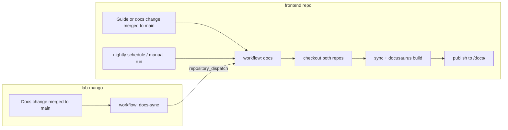

# How docs are synced

## Principles

1. **One source per document.** User guides are written in this site (`docs-site/docs/guides/`). Engineering docs
   stay in the repository whose code they describe and are reviewed in the same pull request as the code.
2. **Nobody edits the copies.** `docs-site/docs/developer/frontend/` and `.../backend/` are generated and
   gitignored. Every synced page has an **Edit this page** link and a note that point to its source file.
3. **Every merged change publishes itself.** A change to docs in either repository rebuilds and redeploys the site.

## What is synced

| Source | Files | Appears under |
|---|---|---|
| Frontend repository | `README.md`, `docs/**/*.md` | Developer › Frontend |
| `lab-mango` | `README.md` | Backend › Getting started |
| `lab-mango` | `AGENTS.md`, `.github/instructions/*.instructions.md` | Backend › Engineering rules |
| `lab-mango` | `docs/**/*.md` | Backend › Architecture, Conventions, API standards, … |
| `lab-mango` | `core/**/docs/*.md` (feature docs next to the code) | Backend › Feature specs › *app* › *feature* |
| `lab-mango` | `packages/*/README.md` | Backend › Packages |

To publish a new kind of document, extend `include` and the destination mapping in
`docs-site/scripts/sync-docs.mjs`.

While copying, `scripts/sync-docs.mjs`:

- rewrites relative links: a link to another synced page goes to its copy; a link to code or any other file goes to
  that file on GitHub;
- copies images that a page uses;
- removes tool-only front matter (for example Copilot's `applyTo:`);
- names feature pages by file (Specification, Architecture, …) in the sidebar.

## Automation



- **Frontend repository, `.github/workflows/docs.yml`:** builds the site on every pull request that touches docs, so
  broken links fail before the merge. It builds and publishes on push to `main`, when `lab-mango` reports a docs
  change, every night as a fallback, and on manual runs.
- **`lab-mango`, `.github/workflows/docs-sync.yml`:** on push to `main` that changes any synced path, it sends a
  `backend-docs-updated` event to the frontend repository.

### One-time setup

| Secret | Repository | Value |
|---|---|---|
| `DOCS_DISPATCH_TOKEN` | `lab-mango` | Fine-grained token with **Contents: read and write** on the frontend repository only (needed to send `repository_dispatch`) |
| `LAB_MANGO_READ_TOKEN` | frontend | Fine-grained token with **Contents: read** on `lab-mango` only (needed to check it out) |

Publishing is the `publish` job in `docs.yml`. It uploads the built site as the `docs-site` artifact; connect it to
the same deployment as the app (see below).

## Serving the site with the app

The site is built with base URL `/docs/` and is served by the same host as the app, so everyone who can reach Lab
Mango can read it without signing in. The app's header links to it. The SPA fallback must not swallow `/docs/`. With
Nginx:

```nginx
location /docs/ {
    alias /var/www/labmango/docs/;      # contents of docs-site/build
    try_files $uri $uri/ $uri/index.html /docs/404.html;
}

location / {
    try_files $uri /index.html;         # the app
}
```

Or build both into one folder: `npm run build:all` in the frontend repository writes the app to `build/` and the
docs to `build/docs/`.

Build-time variables: `DOCS_SITE_URL` (public origin), `DOCS_BASE_URL` (default `/docs/`), `DOCS_APP_URL` (link back
to the app, default `/`), `LAB_MANGO_DIR` (backend checkout, default `../lab-mango` next to the frontend repository).
In the app, `VITE_DOCS_URL` overrides the header link (default `/docs/`).

## Work on the docs locally

```bash
# frontend repo, with lab-mango cloned next to it (or set LAB_MANGO_DIR)
cd docs-site
npm ci
npm start          # sync + live preview on http://localhost:3001/docs/
npm run build      # sync + production build, fails on broken links
```

Changing a backend doc? Edit it in `lab-mango` and run `npm start` here to preview it. The sync runs on every start.
